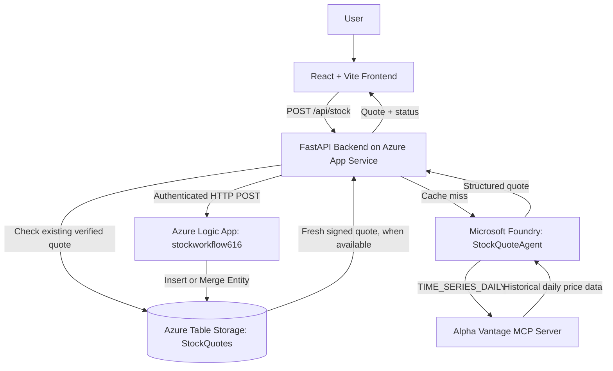
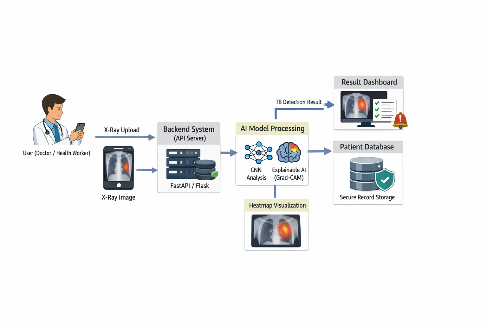

# StockQuote AI

### Azure-Integrated Stock Market Dashboard with Microsoft Foundry, Alpha Vantage MCP, FastAPI, and Azure Table Storage

StockQuote AI is a deployed, full-stack stock market dashboard that connects a React frontend to a Python FastAPI backend, a Microsoft Foundry AI agent, the Alpha Vantage Model Context Protocol (MCP) server, and an Azure Logic App that stores stock quotes in Azure Table Storage.

The project focuses on **end-to-end cloud integration, AI-agent tool calling, automated data persistence, secure backend communication, and quota-aware caching**. It retrieves **historical daily closing prices**, not real-time market quotes.

**Live application:** https://wonderful-sky-03985c300.2.azurestaticapps.net  
**Backend health endpoint:** https://stockquote-api-mithun616-d4gefkevgugmh2fp.centralindia-01.azurewebsites.net/api/health

> **Project status:** Frontend and backend are deployed. Azure Logic App execution and Table Storage writes have been demonstrated. Independent verification of the complete production data-provenance chain for every displayed quote remains a separate validation item.

---

## 1. Project Overview

The application allows users to search for a supported stock symbol, view its latest available daily closing price and trading date, and see the status of its Azure storage operation. The backend coordinates the Foundry agent and MCP market-data tool, manages previously verified quotes, and communicates with Azure services.

### Key capabilities

- Search stocks using ticker symbols such as `MSFT`, `AAPL`, `NVDA`, `TSLA`, `GOOGL`, and `AMZN`.
- Display historical closing prices in USD and the corresponding trading date.
- Invoke a Microsoft Foundry agent backed by `gpt-5-mini` and the Alpha Vantage `TIME_SERIES_DAILY` MCP tool.
- Save stock quote records through an HTTP-triggered Azure Logic App to Azure Table Storage.
- Show backend health, storage feedback, and recent searches in the frontend.
- Use cache-first retrieval with HMAC-SHA256 provenance checks for eligible stored records.
- Reduce repeated provider requests through per-symbol concurrency locks and an HTTP 429 cooldown.
- Reject invented or mock stock prices in the deployed backend configuration.

### Application preview

<!-- Add your sanitized dashboard screenshot to screenshots/dashboard/dashboard-overview.png -->


---

## 2. Technology Stack

| Layer | Technology | Role |
| --- | --- | --- |
| Frontend | React, TypeScript, Vite, Tailwind CSS | Responsive stock dashboard |
| Backend | Python 3.11, FastAPI | API, orchestration, validation, caching |
| AI platform | Microsoft Foundry | Hosting and execution of `StockQuoteAgent` |
| AI model | `gpt-5-mini` | Agent reasoning and tool orchestration |
| Market-data integration | Alpha Vantage MCP | `TIME_SERIES_DAILY` historical stock data |
| Workflow automation | Azure Logic Apps (Consumption) | HTTP-triggered storage workflow |
| Database | Azure Table Storage | Quote persistence and cache records |
| Backend hosting | Azure App Service (Linux, F1) | Deployed FastAPI service |
| Frontend hosting | Azure Static Web Apps | Public web application |
| Authentication | Azure Managed Identity / Azure Identity | Azure service access |
| Testing | Pytest, frontend build checks | Automated verification |

---

## 3. System Architecture



**Important:** The cache-first and provenance-verification paths reflect the optimized backend design. A successful Logic App write alone does not establish that the quote originated from a verified Alpha Vantage response.

<!-- Optional: retain the existing architecture diagram at this path -->


---

## 4. Azure Infrastructure

| Azure resource | Resource name | Purpose |
| --- | --- | --- |
| Resource group | `stock-agent-rg` | Groups project resources |
| Storage account | `stockagent` | Hosts Azure Table Storage |
| Storage table | `StockQuotes` | Persists stock quote entities |
| Logic App | `stockworkflow616` | Receives and stores quote data |
| Foundry resource | `stock-foundry-us616` | AI service resource |
| Foundry project | `StockQuotesAgentUS` | Agent workspace |
| Foundry agent | `StockQuoteAgent` | Calls market-data MCP tool |
| Model | `gpt-5-mini` | Agent model |
| Backend App Service | `stockquote-api-mithun616` | Hosts FastAPI |
| Static Web App | `stockquote-web-mithun616` | Hosts frontend |

The backend App Service uses a Linux Python runtime and the Free F1 tier. The frontend uses Azure Static Web Apps. Logic App Consumption and storage operations may incur usage-based charges; actual billing depends on subscription and usage.

---

## 5. Development and Implementation Journey

The following headings summarize the implementation sequence without step-by-step portal instructions.

### Phase 1 — Azure foundation
- Create and configure the Azure subscription and resource group.
- Create the Azure Storage account.
- Create the `StockQuotes` table.
- Review resource access and authentication.

### Phase 2 — Workflow automation
- Create the Consumption Logic App.
- Configure the HTTP request trigger.
- Configure the Table Storage **Insert or Merge Entity (V2)** action.
- Configure the JSON response action.
- Test the HTTP-to-Table-Storage workflow.
- Inspect Logic App run history and stored entities.

### Phase 3 — AI and market-data integration
- Create the Microsoft Foundry resource and project.
- Configure the `gpt-5-mini` model.
- Create and test `StockQuoteAgent`.
- Connect the Alpha Vantage MCP server.
- Invoke the `TIME_SERIES_DAILY` tool.
- Validate historical closing-price responses and quota behavior.

### Phase 4 — Backend engineering
- Build the Python FastAPI application.
- Integrate Microsoft Foundry using Azure Identity.
- Add stock-symbol validation and structured responses.
- Integrate the Logic App storage workflow.
- Implement verified caching and HMAC-SHA256 provenance checks.
- Add single-flight concurrency protection and provider cooldown.
- Add automated backend tests.

### Phase 5 — Frontend engineering
- Build the React and TypeScript dashboard.
- Add stock search and popular-symbol shortcuts.
- Display daily closing prices, trading dates, and storage status.
- Add backend health indication and recent searches.
- Connect the frontend to the deployed API.

### Phase 6 — Cloud deployment and validation
- Deploy the backend to Azure App Service.
- Configure managed identity and required Azure permissions.
- Deploy the frontend to Azure Static Web Apps.
- Validate API health and frontend connectivity.
- Verify Logic App executions and Table Storage persistence.
- Deploy and test the quota-optimized backend release.
- Prepare a sanitized GitHub repository and project documentation.

---

## 6. Implementation Screenshots

Screenshots document the actual development process. **Image links below are intended file locations**: add the corresponding images to the repository before publishing. Redact account identifiers, access keys, signed Logic App callback URLs, API tokens, and other credentials.

### 6.1 Azure resources and storage


*Azure resources used by StockQuote AI.*


*Azure Table Storage entities created during workflow testing.*

### 6.2 Azure Logic App


*HTTP request trigger, Insert or Merge Entity action, and response action.*


*Table Storage connector and entity mapping.*


*Successful workflow execution shown in Azure run history.*

### 6.3 Microsoft Foundry agent and MCP integration


*StockQuoteAgent configured with `gpt-5-mini`.*


*Custom MCP tool integration.*


*Foundry agent invoking `TIME_SERIES_DAILY` for historical market data.*

### 6.4 Python integration and testing


*Python SDK integration with Microsoft Foundry and Azure Logic App.*


*Backend test execution.*

### 6.5 Deployed application


*Deployed StockQuote AI dashboard showing a quote, trading date, and storage status.*


*Azure App Service deployment and health verification.*

---

## 7. API Overview

| Method | Endpoint | Description |
| --- | --- | --- |
| `GET` | `/api/health` | Backend health and configuration status |
| `POST` | `/api/stock` | Retrieve a stock quote and storage status |
| `GET` | `/docs` | Interactive FastAPI documentation |
| `GET` | `/openapi.json` | OpenAPI specification |

Example request:

```json
{
  "symbol": "MSFT"
}
```

The response includes quote and workflow information. Field availability and exact response shape are defined by the deployed OpenAPI specification. Historical prices are not live trading prices.

---

## 8. Local Development

### Requirements

- Python 3.11 or later
- Node.js and npm compatible with the frontend project
- Azure credentials and permissions for the Foundry integration
- A configured Azure Logic App endpoint and backend authentication secret

### Backend

```bash
cd backend
python -m pip install -r requirements.txt
```

Create `backend/.env` from `backend/.env.example`, using your own Azure configuration and secrets. Never commit the completed `.env` file.

```bash
python -m uvicorn main:app --reload --host 127.0.0.1 --port 8000
```

### Frontend

```bash
cd frontend
npm install
npm run dev
```

The repository also contains Windows launch scripts, including `run-all.ps1`, `run-backend.ps1`, and `run-frontend.ps1`.

---

## 9. Security and Reliability

- **Managed identity:** Access to Azure resources without embedding Azure account credentials in source code.
- **Authenticated workflow requests:** The backend protects its Logic App integration with a server-side authentication token.
- **Quote provenance:** HMAC-SHA256 signing and constant-time signature verification for eligible cached quotes.
- **Cache validation:** Previously stored records are used only when they satisfy the backend's freshness and verification rules.
- **Concurrency control:** Per-symbol asynchronous locking reduces duplicate provider requests within a backend process.
- **Quota handling:** A 60-second cooldown after provider HTTP 429 responses reduces repeated requests.
- **No fabricated prices:** The deployed configuration disables mock fallback.
- **Secret hygiene:** Production credentials, signed callback URLs, and private environment files must remain outside the public repository.

**Scope limitation:** The per-symbol locks and cooldown are process-local; they are not a distributed coordination system for multiple backend instances.

---

## 10. Testing and Validation

| Verification | Reported outcome |
| --- | --- |
| Backend quota-optimization tests | 7 passed |
| Backend regression tests | 10 passed |
| Total backend tests | 17 passed |
| Azure App Service health check | HTTP 200, optimized version reported |
| Logic App HTTP workflow | Successful executions demonstrated |
| Azure Table Storage persistence | Records visible in Azure Storage browser |
| Microsoft Foundry MCP invocation | `TIME_SERIES_DAILY` tool calls demonstrated |
| Production end-to-end quote provenance | Additional independent verification required |

Run the backend tests from the `backend` directory:

```bash
python -m pytest -v
```

Frontend build:

```bash
cd frontend
npm run build
```

These results describe the project tests and screenshots available during development, not a guarantee that all future market-data requests will succeed.

---

## 11. Limitations and Lessons Learned

- **Not real-time:** Alpha Vantage `TIME_SERIES_DAILY` provides historical end-of-day prices, not continuously updating market quotes.
- **Provider quota:** Free-tier Alpha Vantage access can return HTTP 429; new uncached quotes may be temporarily unavailable.
- **Data completeness:** Open, high, low, and volume fields are not always populated in the displayed quote card.
- **Cache provenance:** Older unsigned or unverified records must not be treated as trusted cache entries.
- **Agent output versus evidence:** A model-generated price or successful workflow status is not, by itself, proof of an authenticated provider response.
- **Scale:** The current in-process concurrency controls would need distributed coordination for multi-instance deployment.
- **Operational constraints:** Cloud service quotas, permissions, subscriptions, and billing may affect availability.

This project provided practical experience connecting an AI agent to an external MCP tool, integrating Azure serverless workflows, securing cloud services, and deploying a full-stack application.

---

## 12. Project Completion Checklist

### Completed

- [x] Azure resource group and Storage account created.
- [x] `StockQuotes` Azure Table created.
- [x] HTTP-triggered Azure Logic App configured.
- [x] Table Storage Insert or Merge Entity action configured.
- [x] Logic App success response and run history demonstrated.
- [x] Microsoft Foundry project and `StockQuoteAgent` configured.
- [x] `gpt-5-mini` model integrated.
- [x] Alpha Vantage MCP server and `TIME_SERIES_DAILY` tool tested.
- [x] Python FastAPI backend implemented.
- [x] React/TypeScript frontend implemented.
- [x] Backend deployed to Azure App Service.
- [x] Frontend deployed to Azure Static Web Apps.
- [x] Backend health endpoint verified.
- [x] Azure Table Storage write operations demonstrated.
- [x] HMAC provenance-checking and verified-cache logic implemented.
- [x] Per-symbol request deduplication and provider cooldown implemented.
- [x] Optimized backend version deployed.
- [x] 17 backend tests reported passing.

### Pending or not fully achieved

- [ ] Independently validate the complete **production** chain for a newly fetched quote: Alpha Vantage MCP response → Foundry → backend → HMAC signature → Logic App → stored entity → verified cache read.
- [ ] Capture and publish a redacted, reproducible end-to-end provenance verification report.
- [ ] Verify cache hits and provider quota savings under representative production traffic.
- [ ] Implement distributed request coordination for multiple backend instances, if scaling is needed.
- [ ] Add richer historical charts and complete OHLCV display, if supported by the data source.
- [ ] Add production monitoring and alerting appropriate to the deployment.
- [ ] Upload all final redacted screenshots to the paths used in this README.

---

## 13. Repository Organization

```text
StockQuote-AI-GitHub/
├── backend/                 # FastAPI, Foundry integration, tests
├── frontend/                # React, TypeScript, Vite UI
├── azure_config/            # Sanitized Azure configuration references
├── deployment/              # Deployment scripts and infrastructure templates
├── docs/                    # Additional project documentation
├── screenshots/
│   ├── architecture/
│   ├── azure_services/
│   ├── dashboard/
│   ├── deployment/
│   └── testing/
├── run-all.ps1
├── run-backend.ps1
├── run-frontend.ps1
├── .gitignore
└── README.md
```

---

## 14. Disclaimer

StockQuote AI is an educational and portfolio project. Its data is historical and may be delayed or unavailable. It does not provide investment advice, order execution, or guaranteed market-data accuracy. Microsoft Azure, Microsoft Foundry, and Alpha Vantage are third-party services with their own usage limits and terms.

---

**Project repository:** [Mithun616](https://github.com/Mithun616)  
**Project type:** Full-stack cloud application / AI-agent integration / Azure automation
